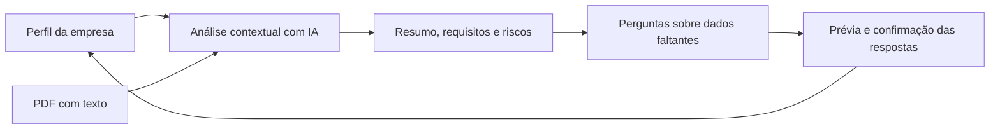

# Assistente Inteligente para Análise de Contratos

**Entenda o documento. Compare com a sua empresa. Decida com mais contexto.**

Backend desenvolvido para o Hackathon 2026 que utiliza IA generativa para analisar
contratos, editais e propostas a partir do perfil de cada empresa. A solução reúne
requisitos, prazos, valores, obrigações e riscos em uma resposta estruturada, com
evidências extraídas do documento.

Quando uma informação falta no perfil, o assistente gera perguntas. As respostas
são interpretadas pela IA, revisadas pelo usuário e incorporadas ao perfil somente
após confirmação. Com os novos dados, o documento é reavaliado.

[Como funciona](#como-funciona) · [Executar localmente](#executar-localmente) · [API](#api) · [Documentação](#documentação)

## O que a solução entrega

| Recurso | Como funciona |
| --- | --- |
| Análise contextual | Cruza o conteúdo do documento com o cadastro e os fatos confirmados da empresa. |
| Resumo e extração | Organiza prazos, valores, obrigações, requisitos e riscos em JSON. |
| Evidências | Associa os itens extraídos a trechos do documento e valida sua existência no texto. |
| Aderência e cobertura | Calcula quanto dos requisitos avaliados foi atendido e quanto já pôde ser avaliado. |
| Perguntas sobre lacunas | Identifica informações desconhecidas e gera perguntas relacionadas aos requisitos. |
| Confirmação de respostas | Apresenta os fatos propostos antes de salvar e exige autorização para substituir valores já confirmados. |
| Reavaliação | Atualiza o resultado com o perfil mais recente e preserva a análise anterior em caso de falha. |
| Acesso por empresa | Autentica por JWT e restringe documentos e lotes de respostas à empresa proprietária. |

## Como funciona



1. **Cadastre e confirme o perfil.** Informe os dados da empresa e confirme as informações que poderão sustentar a análise.
2. **Envie um documento.** O backend recebe o PDF e extrai seu texto.
3. **Solicite a análise.** A IA interpreta o documento, compara requisitos com o perfil e retorna os itens estruturados.
4. **Revise o resultado.** Consulte as evidências, a classificação, a nota de aderência e a cobertura.
5. **Complete as lacunas.** Responda às perguntas, revise a interpretação e confirme os fatos que devem ser salvos.
6. **Reavalie.** Após a confirmação, o backend atualiza os fatos e executa uma nova análise.

As chamadas de IA são síncronas. O upload e a primeira análise são operações
separadas; a confirmação de respostas já dispara a reavaliação.

## Como interpretar o resultado

A nota é calculada pelo backend, com peso igual para todos os requisitos:

- **Aderência:** percentual de requisitos atendidos entre os que foram avaliados.
- **Cobertura:** percentual de requisitos avaliados entre todos os identificados.
- **Desconhecido:** falta informação para concluir; não significa descumprimento.

Por exemplo, um requisito atendido, um não atendido e um desconhecido produzem
**aderência de 50%** e **cobertura de 67%**. A nota deve ser lida junto da cobertura.
Sem requisitos avaliados, a nota é nula.

| Classificação | Significado |
| --- | --- |
| `incompatible` | Existe requisito obrigatório comprovadamente não atendido. |
| `high_risk` | Existe risco de severidade alta ou crítica. |
| `insufficient_data` | Há comparações desconhecidas, papel não resolvido ou nenhum requisito avaliável. |
| `good_fit` | A análise não identificou os impedimentos anteriores. |

A classificação segue essa ordem de prioridade. Uma nota alta pode coexistir
com incompatibilidade quando um requisito obrigatório não é atendido.

## Tecnologias

| Camada | Tecnologia |
| --- | --- |
| Linguagem | Python — ambiente validado com a versão 3.12 |
| Backend e API | Django e Django REST Framework |
| Autenticação | JWT com SimpleJWT; login por e-mail ou CNPJ |
| IA generativa | Google Gemini, via Google Gen AI SDK |
| Validação estruturada | Pydantic e JSON Schema |
| Extração de PDF | PyPDF2 |
| Persistência local | SQLite e armazenamento de arquivos em `MEDIA_ROOT` |

As dependências e suas versões estão em [requirements.txt](requirements.txt).

## Executar localmente

Os comandos abaixo usam PowerShell, na raiz do projeto, sem exigir ativação do
ambiente virtual. É necessária uma chave do Gemini para executar análises reais.

### 1. Preparar o ambiente

```powershell
python -m venv .venv
.\.venv\Scripts\python.exe -m pip install -r requirements.txt

if (-not (Test-Path .env)) { Copy-Item .env.example .env }
```

### 2. Configurar as variáveis

Gere uma chave secreta para o Django:

```powershell
.\.venv\Scripts\python.exe -c "from django.core.management.utils import get_random_secret_key; print(get_random_secret_key())"
```

Edite o `.env` usando [.env.example](.env.example) como referência:

```dotenv
SECRET_KEY=cole_a_chave_gerada
DEBUG=True
ALLOWED_HOSTS=localhost,127.0.0.1
GOOGLE_AI_API_KEY=cole_sua_chave_do_gemini
GOOGLE_AI_MODEL=gemini-3.5-flash-lite
```

`GOOGLE_AI_MODEL` é opcional: se estiver ausente ou vazio, o backend usa
`gemini-3.5-flash-lite`. A disponibilidade do modelo depende do acesso da chave
configurada. O `.env` é ignorado pelo Git.

### 3. Criar as tabelas e iniciar a API

```powershell
.\.venv\Scripts\python.exe manage.py migrate
.\.venv\Scripts\python.exe manage.py runserver
```

API local: **`http://localhost:8000/api/v1/`**.

O cadastro inicial recebe e-mail, senha e CNPJ. Os dados adicionais do perfil são
preenchidos e confirmados pelo endpoint da empresa; a consulta automática de CNPJ
ainda não está implementada.

## API

Todas as rotas abaixo são relativas a `/api/v1/`. As operações de empresa e
documentos exigem o token de acesso:

```http
Authorization: Bearer <access>
```

| Método | Endpoint | Finalidade |
| --- | --- | --- |
| POST | `auth/register/` | Criar a conta e obter os tokens. |
| POST | `auth/login/` | Autenticar por e-mail ou CNPJ. |
| POST | `auth/refresh/` | Renovar o token de acesso. |
| GET / PATCH | `companies/me/` | Consultar, editar e confirmar o cadastro. |
| GET / POST | `documents/` | Listar documentos ou enviar um PDF. |
| GET / DELETE | `documents/{id}/` | Consultar o resultado completo ou excluir o documento. |
| POST | `documents/{id}/analyze/` | Executar a primeira análise. |
| POST | `documents/{id}/answers/preview/` | Interpretar respostas e gerar propostas de fatos. |
| POST | `documents/{id}/answers/{batch_id}/confirm/` | Confirmar fatos e reavaliar. |
| POST | `documents/{id}/reanalyze/` | Reavaliar um documento com análise existente. |

### Upload de documentos

O upload usa `multipart/form-data`, com o arquivo em `file` e `doc_type` opcional:
`contract`, `tender` ou `proposal`. São aceitos PDFs de até **10 MB**, limite definido
por `MAX_DOCUMENT_UPLOAD_SIZE`.

Os arquivos são armazenados localmente sob `MEDIA_ROOT` e abertos pelo storage
do Django para extração. O texto é extraído durante o upload e salvo em
`Document.text_content`. O caminho de armazenamento e o texto extraído não são
expostos na resposta da API; não há endpoint de download nesta etapa.

PDFs corrompidos ou protegidos por senha retornam `400`, com erro no campo
`file`. Falhas de extração ou persistência removem o arquivo salvo para evitar
arquivos órfãos. A exclusão de um documento remove o registro e o arquivo.

PDFs sem texto são aceitos com `text_content` vazio; não há OCR nesta etapa.
A análise por IA exige texto extraído não vazio.

### Consulta de documentos

A listagem é paginada e inclui `score`, `cobertura` e `outcome`. O detalhe também
retorna `analysis_json` e `analysis_desatualizada`, que compara o perfil atual com
o contexto utilizado no resultado salvo.

## Documentação

| Guia | Conteúdo |
| --- | --- |
| [Autenticação](core/modules/auth/docs/index.md) | Cadastro, login, tokens e formatos de requisição. |
| [Perfil da empresa](core/modules/company/docs/index.md) | Campos cadastrais e operações da conta autenticada. |
| [Contrato de análise](core/modules/documents/docs/analysis.md) | JSON de saída, evidências, indicadores e estados do documento. |
| [Respostas e confirmação](core/modules/documents/docs/answers.md) | Prévia, autorização de substituição, reavaliação e tratamento de falhas. |

## Testes e verificações

```powershell
.\.venv\Scripts\python.exe manage.py test core
.\.venv\Scripts\python.exe manage.py check
.\.venv\Scripts\python.exe manage.py makemigrations --check --dry-run
```

Os testes simulam o Gemini, sem consumir a API real. Cobrem validação de evidências,
cálculo dos indicadores, isolamento entre empresas, confirmação de fatos,
concorrência e preservação dos resultados em caso de falha. Também verificam a
serialização dos schemas pelo SDK real com o transporte HTTP simulado.

Os testes de upload usam PDFs reais, autenticação JWT, banco de teste e
armazenamento temporário. Verificam extração de texto, limite de tamanho,
arquivos inválidos ou protegidos, isolamento entre empresas e remoção dos
arquivos após exclusão ou falhas de processamento.

## Organização do projeto

```text
config/                       Configurações e rotas da aplicação
core/
├── models.py                 Empresas, fatos, documentos e lotes de respostas
├── migrations/               Evolução do banco de dados
├── modules/
│   ├── auth/                 Cadastro e autenticação
│   ├── company/              Perfil da empresa
│   └── documents/            Upload, análise, respostas e reavaliação
├── tests.py                  Testes da API de documentos
├── test_document_upload.py   Testes de upload, extração e armazenamento
├── test_analysis.py          Testes da análise contextual
└── test_answers.py           Testes do ciclo de respostas
```

## Escopo atual e próximos passos

Este repositório contém o backend. A versão atual processa PDFs com texto
extraível, utiliza armazenamento local e recebe respostas apenas para fatos da
empresa. Perguntas sobre cadastro seguem pela edição do perfil; perguntas sobre
o papel da empresa no documento permanecem pendentes.

Próximas etapas previstas no fluxo da solução:

- Consulta automática de dados cadastrais por CNPJ.
- Suporte a DOCX e OCR para documentos digitalizados.
- Respostas sobre o papel da empresa no documento.
- Assistente conversacional para perguntas e respostas sobre o documento.

## Licença

Distribuído sob a [licença MIT](LICENSE).
